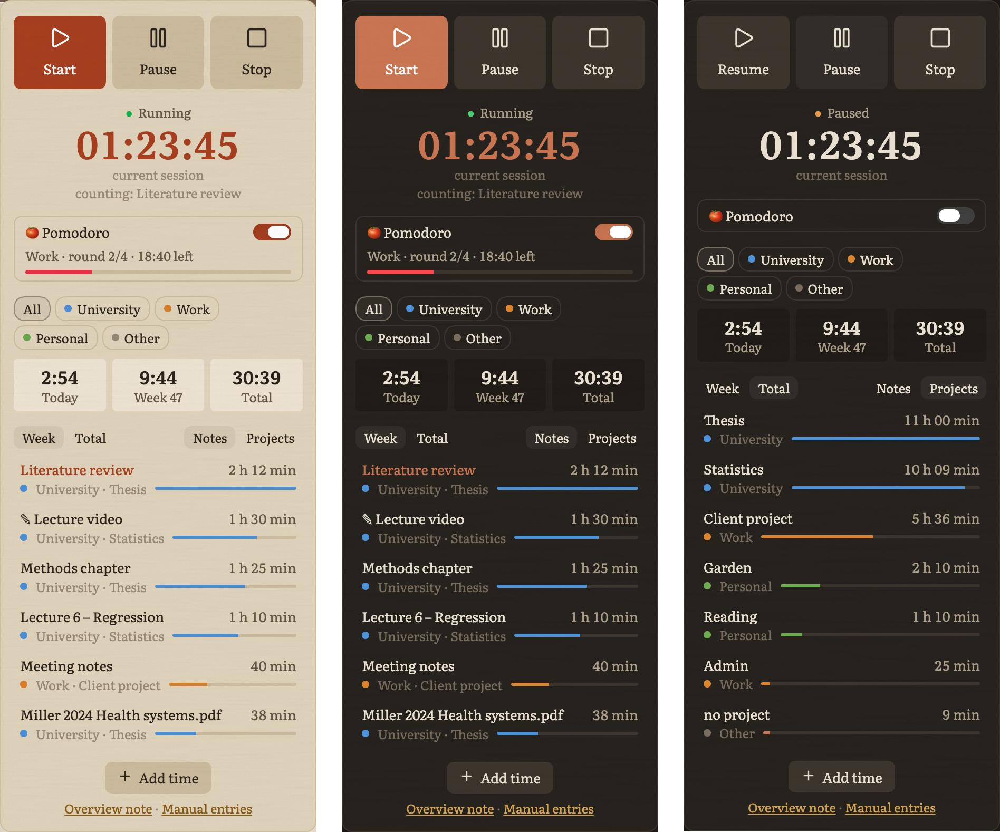
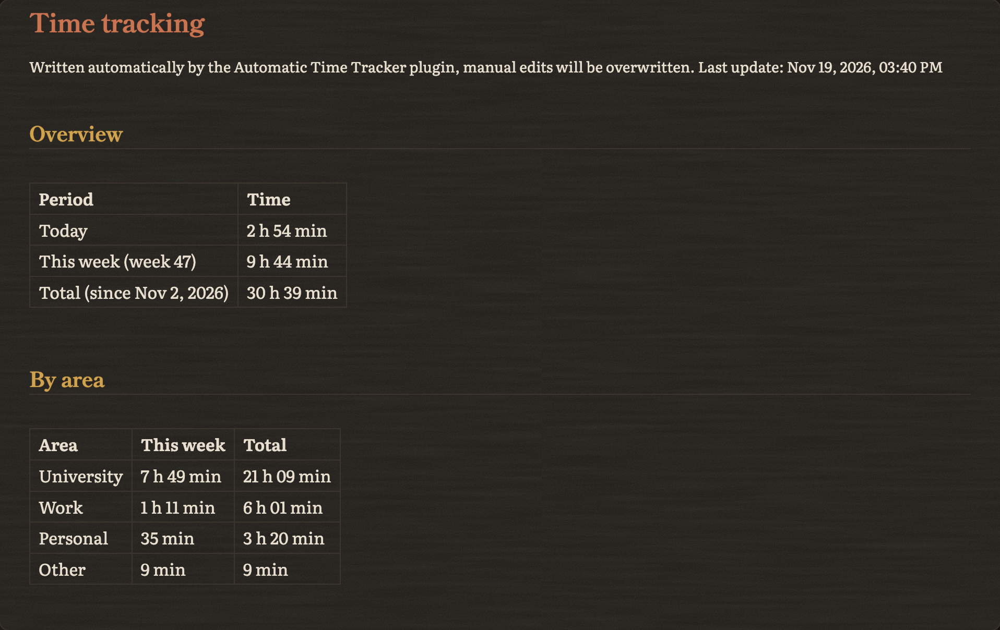
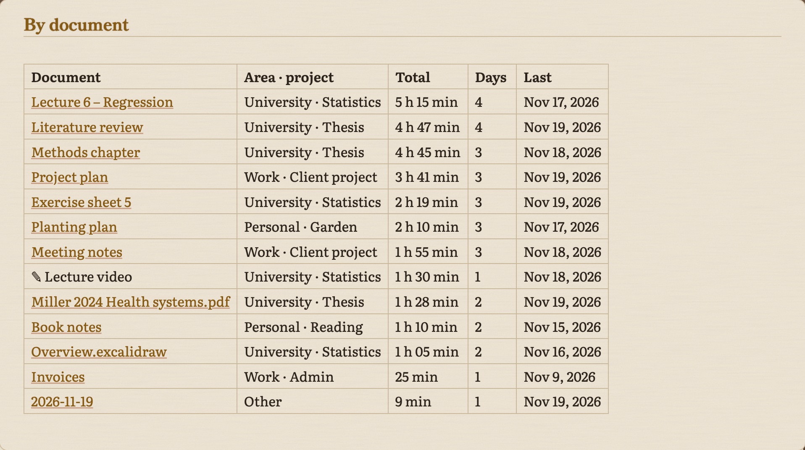

# Automatic Time Tracker

Track time automatically for every note, PDF and drawing in your vault. Press **Start** once – the plugin records how long you work in each document, groups it into areas and projects, and keeps a live overview in your sidebar.



## Features

- **Automatic per-document tracking** – time is booked to the document you are working in (notes, PDFs, Excalidraw drawings, images …). Switching documents switches the counter.
- **Live view** – a sidebar panel with large Start / Pause / Stop buttons, a live session clock (hh:mm:ss), today / this week / total and a list of your documents or projects.
- **Areas and projects** – group your vault into areas such as *University*, *Work* or *Personal*, either by folder or by a property in your notes. The first subfolder of an area becomes the project.
- **Idle and sleep detection** – after a configurable time without mouse or keyboard input (default 5 min) time stops counting, and the idle time is subtracted again. Time while your computer sleeps is never counted.
- **Pomodoro** – optional work phases with short and long breaks, a countdown in the live view and the status bar, an optional sound and a "Resume" prompt when the break is over.
- **Reminder** – if you write for a few minutes without tracking, a notice offers to start. It stays quiet after you pause or stop on purpose.
- **Manual entries** – add time you spent outside Obsidian (reading on paper, watching a lecture video …) to a document or to an area and project.
- **Overview note** – a Markdown note with tables by area, project, document and day. It links to every tracked document, so tracked work shows up in backlinks and the graph.
- **Renames are handled** – renaming or moving files and folders keeps their tracked time.
- **English and German** – follows Obsidian's interface language.

## Installation

**From the community plugins (once approved):** Settings → Community plugins → Browse → search for "Automatic Time Tracker" → Install → Enable.

**Manually:** download `main.js`, `manifest.json` and `styles.css` from the [latest release](https://github.com/kluesn/automatic-time-tracker/releases/latest), put them into `<your vault>/.obsidian/plugins/automatic-time-tracker/` and enable the plugin under Settings → Community plugins.

## Getting started

1. Enable the plugin. A clock icon appears in the ribbon and a timer in the status bar.
2. Open the live view: command palette → **Automatic Time Tracker: Open live view**. Drag it wherever you like, e.g. below the file explorer.
3. Press **Start** and work as usual.
4. Optional: define your areas in the settings.

## How time is counted

| Situation | Counted? |
|---|---|
| A note, PDF or drawing is open in the main area and you are active | ✅ for that document |
| Graph view, settings or the overview note are active | ❌ |
| No input for longer than the idle timeout | ❌ (and the idle time is subtracted) |
| Computer is asleep | ❌ |
| You work outside Obsidian | ❌ – add it as a manual entry |

Documents you only opened for less than 30 seconds are summarised instead of listed individually.

## Areas and projects

**By folder** (default): each area has one or more folders. The first subfolder below an area folder is the project.

| Area | Folders | Example | Project |
|---|---|---|---|
| University | `Uni`, `Library/Attachments` | `Uni/Statistics/Lecture 3.md` | Statistics |
| Work | `Work` | `Work/Client A/Notes.md` | Client A |
| *Other* | everything else | `Daily notes/2026-11-16.md` | – |

**By property**: an area property (default `area`) in a note decides, e.g. `area: Work`. Files without properties, such as PDFs, fall back to the folder rules.

**Project property** (optional): for notes that are not inside a project subfolder, the project is read from this property. If its value is a link, the project of the linked note is used.

## Pomodoro

Turn it on in the live view. Defaults: 25 min work, 5 min break, 15 min long break after 4 rounds – all adjustable.

- When a work phase ends, tracking pauses automatically.
- When the break ends, a notice with **Resume** stays until you click it.
- Pausing manually freezes the countdown; Stop ends session and Pomodoro.

## Overview note

Besides the live view, the plugin keeps a Markdown note with your totals by area, project, document and day. Every tracked document is linked, so you can jump straight to it.





## Theme

The screenshots show the [Mokume](https://github.com/kluesn/obsidian-mokume) theme, made by the same author. The plugin works with any theme and follows Obsidian's light and dark mode. If you like the warm, paper-like look, you can install Mokume under Settings → Appearance → Themes → Manage.

## Data and privacy

- Everything stays local. The plugin makes no network requests.
- Tracked time is stored in the plugin's `data.json` inside your vault's config folder.
- The overview note is regenerated every minute while tracking is running. **Edits in that note are overwritten.** Its folder, name and additional frontmatter can be set in the settings.

## Limitations

- **Desktop only.** This avoids two devices writing the same data at the same time when the vault is synced.
- Only time inside Obsidian is tracked automatically.
- The overview note is not meant to be edited by hand.

## Commands

Start · Pause · Stop (end session) · Start/pause · Open live view · Open overview note · Add time manually · Manage manual entries · Toggle Pomodoro

No hotkeys are set by default – assign your own under *Settings → Hotkeys*.

## Building from source

The plugin is written in plain JavaScript (`src/main.js`) and bundled with esbuild:

```bash
npm install
npm run build
```

This creates `main.js` in the repository root. Copy `main.js`, `manifest.json` and `styles.css` into `<your vault>/.obsidian/plugins/automatic-time-tracker/` to test it. Releases are built by a GitHub Actions workflow, which also creates [artifact attestations](https://docs.github.com/en/actions/security-for-github-actions/using-artifact-attestations) for the release files.

## Feedback

Bugs and ideas: please open an [issue](https://github.com/kluesn/automatic-time-tracker/issues).

## License

[MIT](LICENSE)
